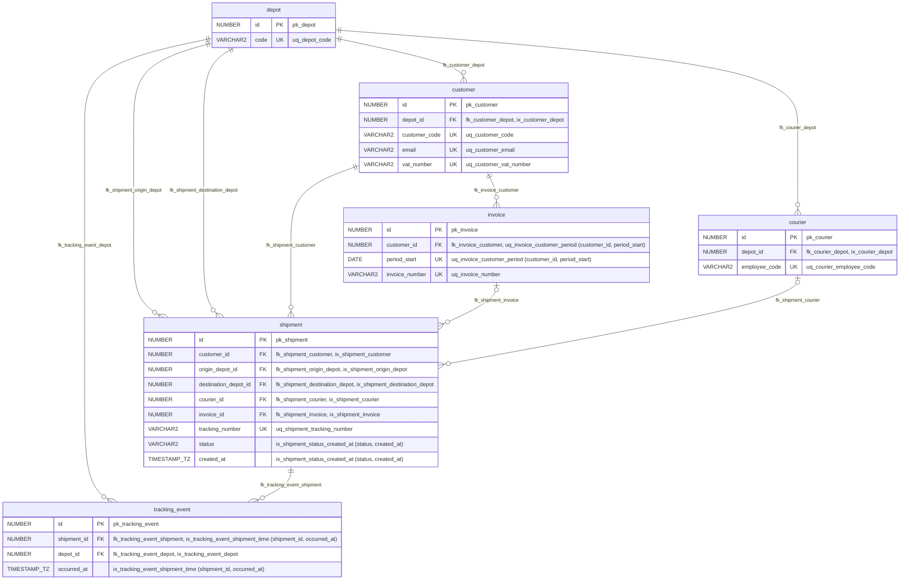
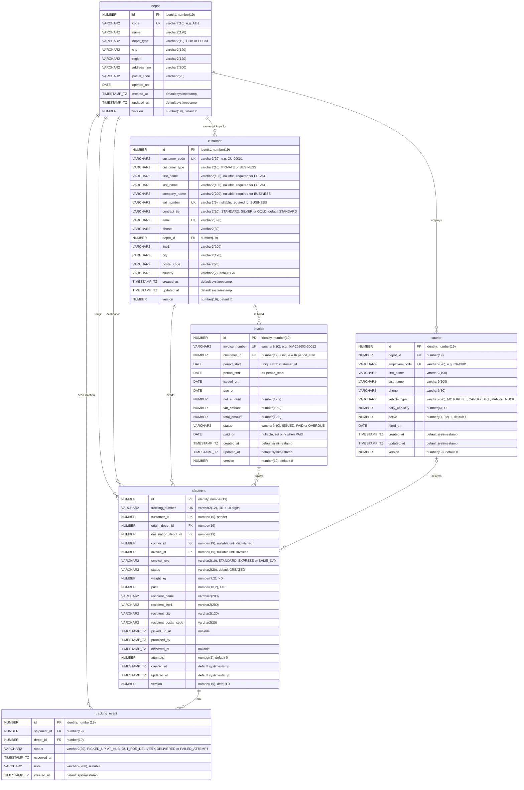

# Dromeas courier delivery: entity relationship diagram

Target schema of `spring-boot-persistence-demo` (Oracle 23ai, schema `DROMEAS`), as created by
`src/main/resources/db/migration/V1__create_delivery_schema.sql`.

## Keys and indexes only

The tables reduced to primary keys, foreign keys and indexed columns. Mermaid has no index marker, so each column's comment names the
index: `ix_*` is a plain index, `uq_*` a unique constraint (backed by a unique index). Every primary key has an implicit index (`pk_*`).

## Full schema, all columns

## Notes

- `shipment.status` allows `CREATED`, `PICKED_UP`, `AT_HUB`, `OUT_FOR_DELIVERY`, `DELIVERED` and `FAILED_ATTEMPT`.
- `tracking_event` is an append-only log: no `updated_at`, no `version`.
- `customer` carries a check constraint tying the identity columns to `customer_type`: a `PRIVATE` customer has a first and last name
  and no company or VAT number; a `BUSINESS` customer has a company name and a VAT number.
- Foreign-key columns are indexed (`ix_*`), plus `ix_shipment_status_created_at` on `(status, created_at)` and
  `ix_tracking_event_shipment_time` on `(shipment_id, occurred_at)`.
